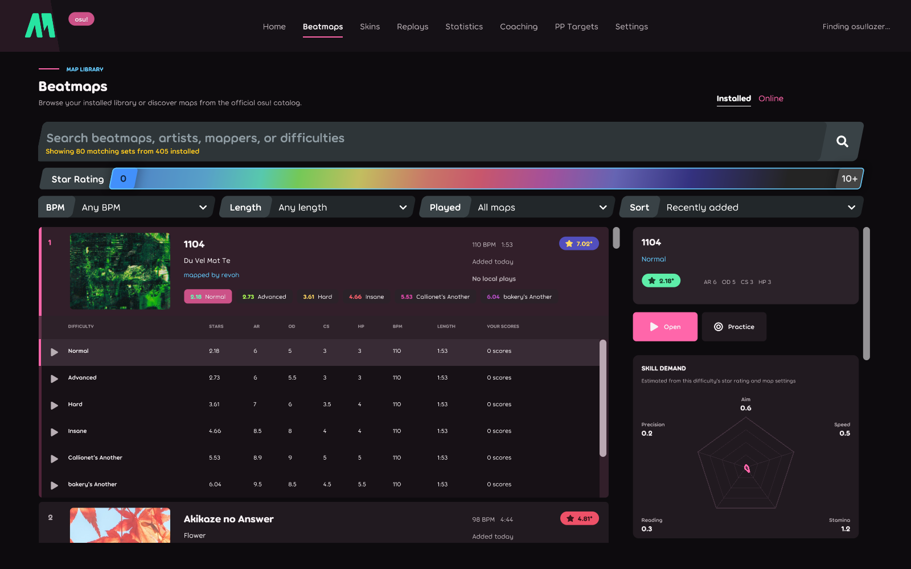
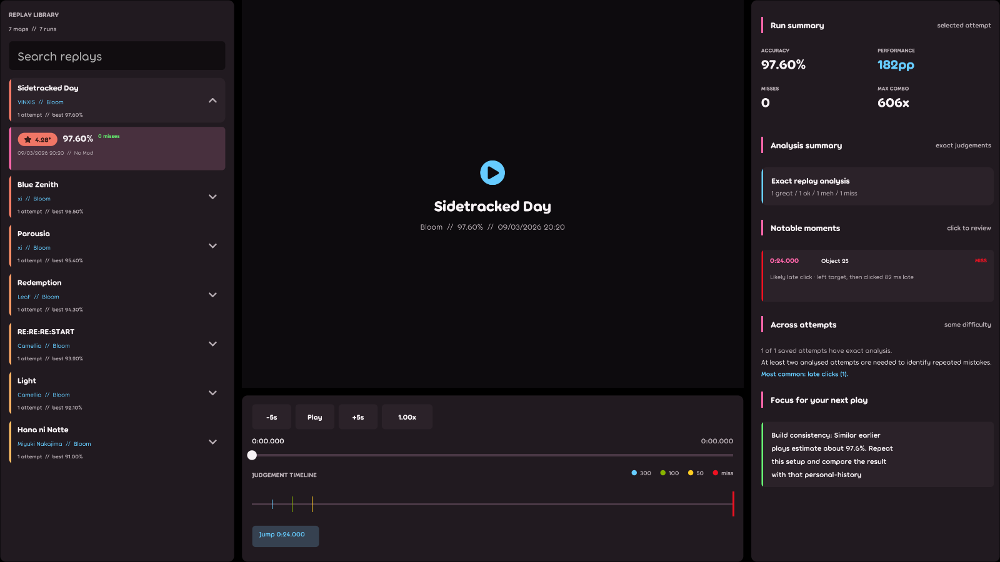
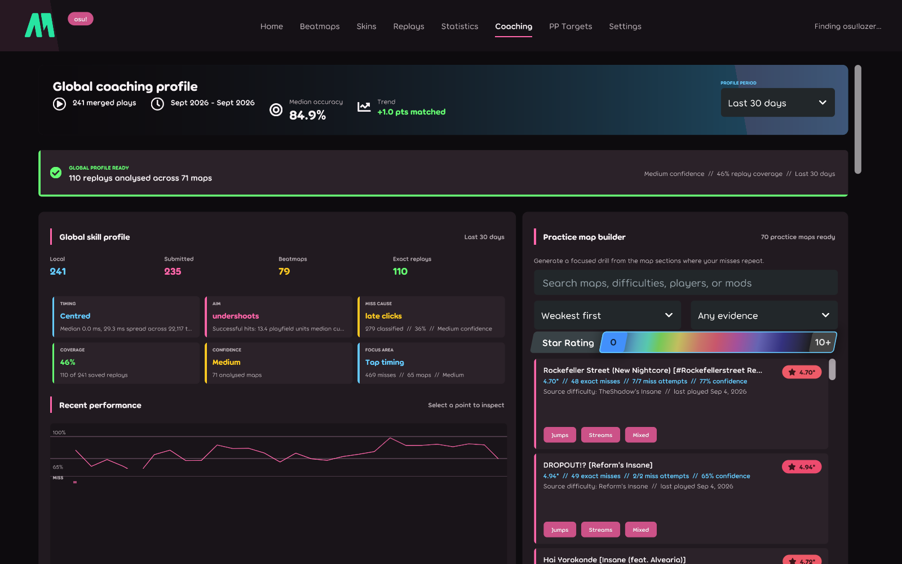
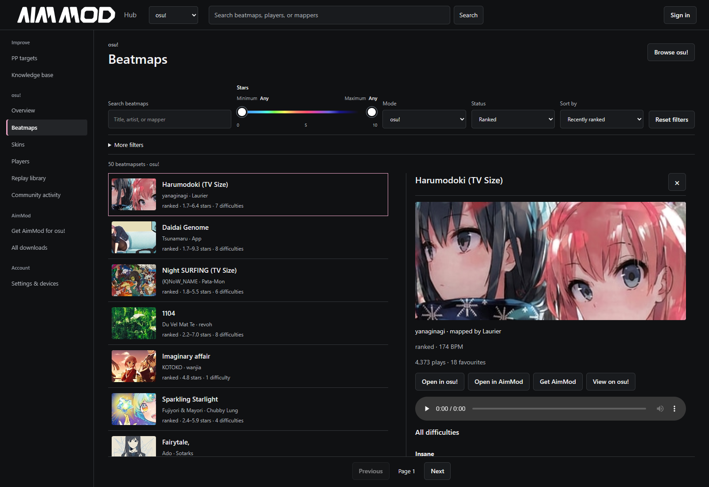
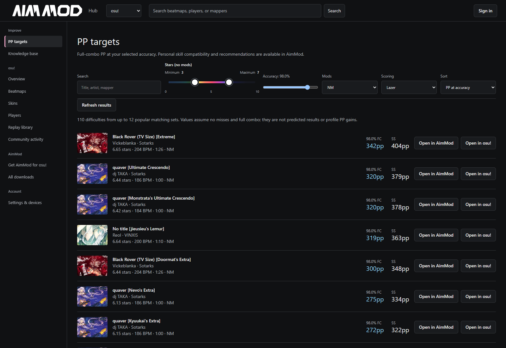
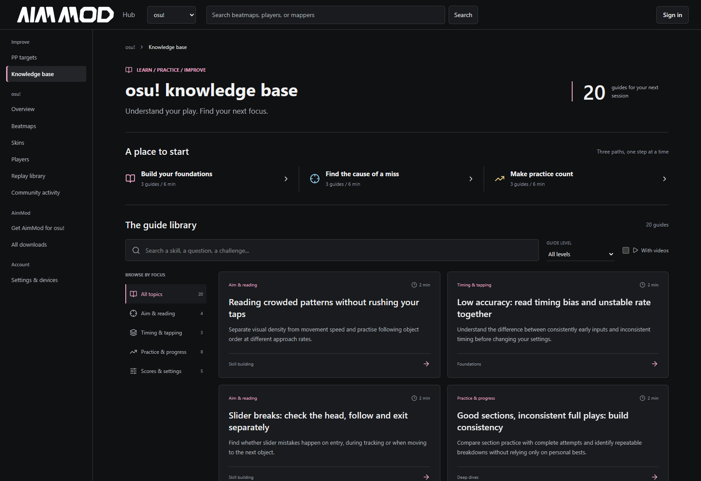

# AimMod

[Join the AimMod Discord](https://aimmod.app/join) for updates, feedback and support.

AimMod is a performance-analysis and coaching suite for osu! and KovaaK's Aim Trainer. Each game has a dedicated experience and release channel built around its data and practice workflow.

| Product | Platforms | Download |
| --- | --- | --- |
| AimMod for osu! | Windows x64, Linux x64 | [Stable channel](https://github.com/veryCrunchy/aimmod/releases/tag/aimmod-osu-stable) |
| AimMod for KovaaK's | Windows | [In-game installer](https://github.com/verycrunchy/aimmod/releases/download/aimmod-ingame-stable/AimMod-Setup.exe) |

## AimMod for osu!

AimMod for osu! is a native osu.Framework desktop application. It combines local osu!stable and osu!lazer history, replay-backed object analysis, and online scores into one workspace for map discovery, performance review, coaching, and focused practice.

### Beatmap intelligence and PP targets



- Browse installed beatmaps and inspect each difficulty separately
- Compare aim, speed, stamina, reading, and accuracy demand
- Calculate PP at multiple accuracy targets with the official osu! ruleset stack
- Rank recommendations by personal fit, expected PP, realistic maximum PP, stars, length, status, and mods
- Open maps directly in osu! or save recommendations for later

### Replay analysis



- Play local replays with the selected skin, audio controls, seeking, and exact judgement timeline
- Classify misses from cursor and click evidence, including overshoots, undershoots, early clicks, late clicks, and unstable aim
- Compare repeat attempts on the same difficulty to identify recurring failure points
- Keep replay state isolated per workspace and pause playback when switching tabs

### Global coaching and practice



- Build a recent skill profile across maps with a configurable time window
- Analyse replay evidence in the background and cache completed calculations
- Turn recurring jump, stream, timing, and reading weaknesses into longer practice maps with lead-in and repetition
- Combine detailed local records with online best and recent scores

### osu! clients, skins, and sharing

- Discover beatmaps, scores, replays, and installed skins from both osu!stable and osu!lazer
- Choose Auto, osu!stable, or osu!lazer as the destination for beatmaps, skins, and generated practice maps
- Browse attributed catalogs from osuskins.net and skins.osuck.net, inspect screenshots, and keep downloads temporary until saving or importing
- Validate archive type, size, paths, and redirect hosts before importing; public Google Drive files are supported while MEGA and authenticated or challenged links open in the browser
- Link an AimMod Hub account with a device code and manually share a score, replay file, or judgement analysis as private, unlisted, or public
- Retain an upload queue across restarts with cancel and retry controls. New sharing preferences default to public; private and unlisted are available. Automatic sharing is off until explicitly enabled, with PP and accuracy thresholds.

The native app is self-contained. Stable and preview channels update in place through Velopack on Windows and Linux; portable archives remain available for manual installs. See [the native app guide](osu-native/README.md) and [release-channel documentation](osu-native/docs/release-channels.md).

### AimMod Hub in your browser

[AimMod Hub](https://aimmod.app/osu) complements the desktop app with beatmap and skin discovery, public scores, replay sharing and browser replay playback.

**Beatmap search and difficulty details**



Search the official catalog, filter by difficulty and map settings, inspect a set, and open it in osu! or AimMod. Search preferences are retained across reloads.

**PP at your chosen accuracy**



Compare full-combo PP at a chosen accuracy, mod combination and scoring mode. Results are cached by difficulty revision and calculation settings. These are map calculations, not personal predictions; skill compatibility remains in the desktop app.

**Guides for your next practice session**



The [osu! knowledge base](https://aimmod.app/osu/learn) covers reading, timing, aim control, slider breaks and practice planning, with sources and relevant video resources.

## AimMod for KovaaK's

AimMod runs inside KovaaK's, with live HUDs, session history, replay review,
coaching, and Steam multiplayer. Install it once and launch the game through Steam.

### Install and play

1. Close KovaaK's and download [AimMod Setup](https://github.com/verycrunchy/aimmod/releases/download/aimmod-ingame-stable/AimMod-Setup.exe).
2. Run the installer, confirm the game folder and choose Install. The Beta channel offers upcoming releases.
3. Start KovaaK's from Steam. In KovaaK's, press Esc and click AIMMOD, or press F7.
4. Open Multiplayer to host a lobby or join one, then invite friends through Steam. Everyone needs a compatible AimMod installation.
5. Play a scenario and open AimMod to review your history, replay and coaching.

Updates are downloaded in the background and applied after the game closes.
Use Setup to repair or uninstall. Windows SmartScreen may warn about an unfamiliar
download: verify the official release source before choosing More info and Run anyway.

### Requirements

- Windows 10 or Windows 11
- KovaaK's Aim Trainer installed through Steam
- Steam running for multiplayer

## Build From Source

### Native osu! app

Windows:

```powershell
cd osu-native
./scripts/build-windows-release.ps1
```

Linux:

```bash
cd osu-native
./scripts/build-linux-release.sh
```

### Frontend

```bash
pnpm install
pnpm run build:frontend
```

### Windows app

```bash
pnpm run build:win:dev
```

Release build:

```bash
pnpm run build:win
```

## One-command pipeline

The repo includes a full pipeline that builds:
- `ue4ss-rust-core`
- `ue4ss-mod`
- the staged UE4SS runtime payload
- the Tauri Windows app

Windows / PowerShell:

```powershell
pnpm run pipeline:win
```

Windows dev stripped build:

```powershell
pnpm run pipeline:win:dev:stripped
```

WSL / Linux dev stripped build:

```bash
pnpm run pipeline:wsl:dev:stripped
```

WSL / Linux release stripped build:

```bash
pnpm run pipeline:wsl:release:stripped
```

## Repo Notes

- The overlay frontend lives in `src/`
- The Tauri backend lives in `src-tauri/`
- The UE4SS mod lives in `ue4ss-mod/`
- Runtime payload staging scripts live in `scripts/`
